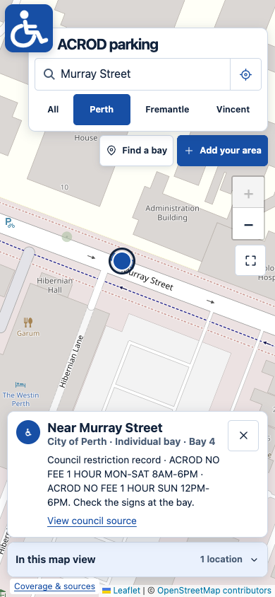

# ACROD parking map

[**Open the live map**](https://m-rk.github.io/acrod-map/)

Find designated accessible parking in the Cities of Perth, Fremantle and Vincent. Use the location icon in the search box to find mapped parking within 25 km, or search by street, suburb or landmark. Open **In this map view** for the list or select a marker.

## Read the markers

- **Solid blue wheelchair symbol** for an individual bay.
- **Striped blue wheelchair symbol** for an approximate location.
- **Dark square with a P** for a car park that has accessible bays.
- **Stacked blue circles** for multiple locations. Select one to see the area or zoom in.

The map shows selected council records. Live availability is unavailable. Check signs and bay markings when you arrive.

Use **Add your area** to preview a GeoJSON file or pasted data, then follow the GitHub link to contribute it for review.

[Council sources and coverage](https://m-rk.github.io/acrod-map/coverage.html) · [Download or contribute GeoJSON](sources/README.md)
