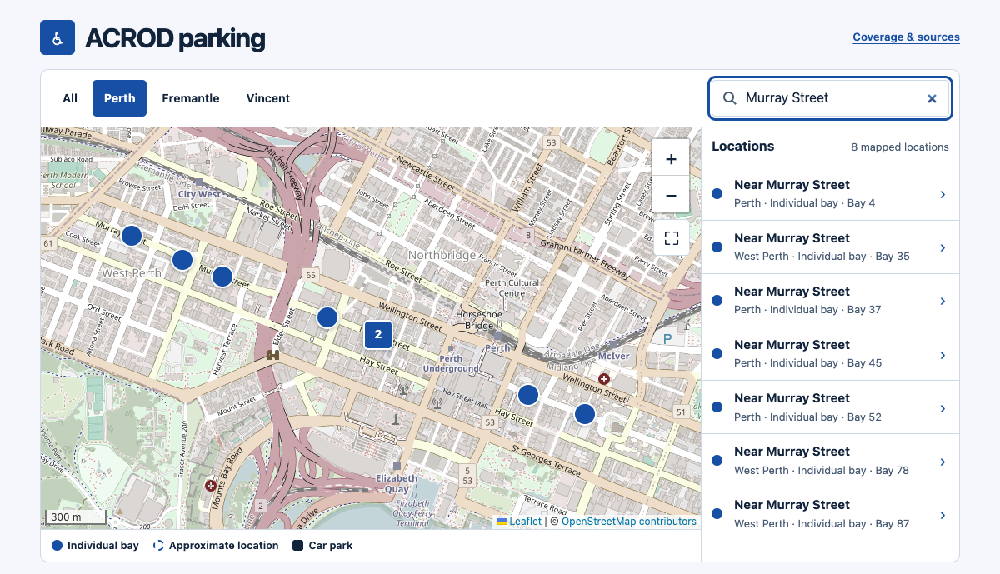
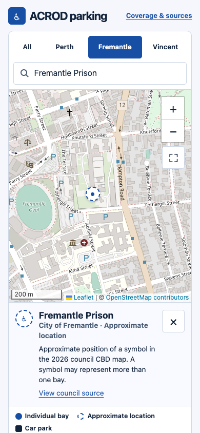

# ACROD parking map

[**Open the live map**](https://m-rk.github.io/acrod-map/)

Find designated accessible parking in the Cities of Perth, Fremantle and Vincent. Search by street, suburb or place, then select a pin or list result for details.

## Read the markers

- **Solid circle** for an individual bay.
- **Dashed circle** for an approximate location.
- **Square with a P** for a car park that has accessible bays.

The map shows selected council records. Live availability is unavailable. Check signs and bay markings when you arrive.

[Council sources and coverage](https://m-rk.github.io/acrod-map/#coverage) · [Data details](data/README.md)
